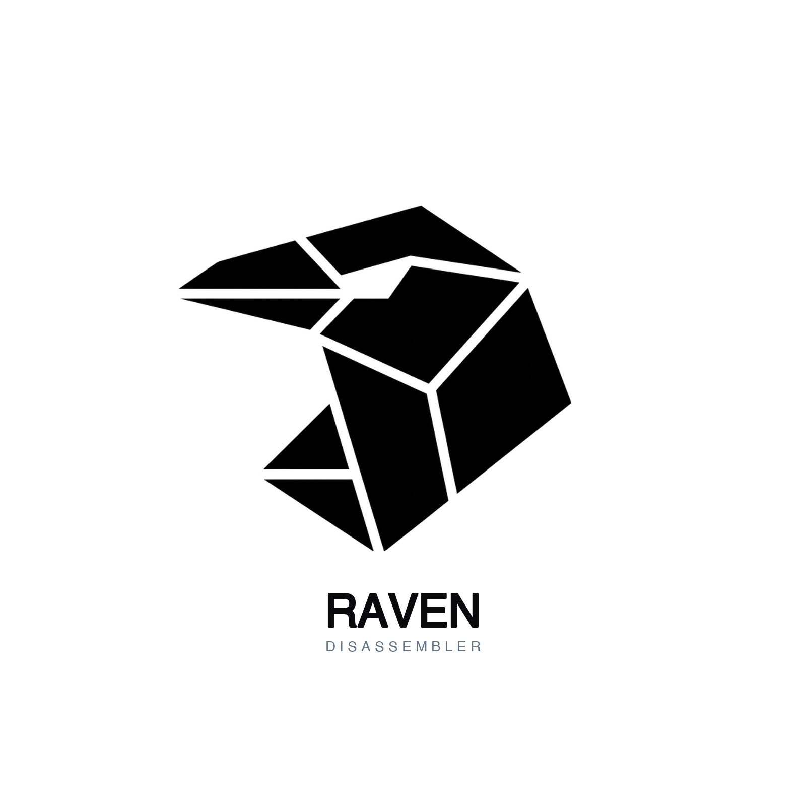

# RAVEN Disassembler



RAVEN is a Rust workbench for static binary analysis. Its desktop GUI, headless CLI, and 30-tool MCP server share one analysis engine. Open ELF, PE/COFF, thin Mach-O, raw images with an explicit mapping, or supported binaries wrapped in gzip.

## Downloads

[Download RAVEN and read the installation guide](https://tantrieunguyen.github.io/raven-disassembler-site/).

| Host | CPU architectures | Installer |
|---|---|---|
| Windows | x86, x64, ARM64 | Setup executable |
| macOS 11 or later | Intel x64, Apple Silicon ARM64 | DMG |
| Debian/Ubuntu Linux | x86, x64, ARM64 | DEB |
| Other compatible Linux distributions | x86, x64, ARM64 | Portable tar.gz |

Choose the installer for the CPU running RAVEN. Every build can analyze x86, x86-64, ARM, Thumb, and ARM64 machine code. See [platforms and compatibility](docs/PLATFORMS.md) for requirements and packaging details.

## Workbench

- Browse procedures, assembly, strings, imports, exports, and sections.
- Navigate a control-flow graph and a synchronized hex view. Follow references with clickable destinations and Back/Forward history.
- Decode direct control flow and statically addressed x86/x64 data operands. Fixed raw pointer slots can produce labeled indirect candidates.
- Generate C pseudocode for supported straight-line x86-64 integer routines using the native lifter. The same model exposes an inferred prototype and supports bounded register-only emulation. An optional Ghidra adapter provides broader pseudocode.
- Read embedded DWARF types and recorded thread PC, SP, and signal from supported Linux ELF64 core dumps.
- Store annotations and exact function signatures in SQLite. Export revisioned annotations and share one project through a restricted MCP session over SSH.

See the [feature matrix](docs/FEATURE-MATRIX.md) for coverage, including the limits on indirect references, decompilation, live debugging, executable packers, and IDA database/plugin interoperability.

## Build and run

Install stable Rust, a native C/C++ toolchain, and the requirements in the [platform guide](docs/PLATFORMS.md). Capstone and SQLite are built through Cargo dependencies.

```sh
cargo test --locked --workspace --features gui
cargo build --locked --release --features gui --bins
./target/release/raven-gui program.bin
./target/release/raven analyze program.bin -o analysis.json
./target/release/raven disasm program.bin 0x401000 --size 128
./target/release/raven raw firmware.bin --mode thumb --base 0x08000000
./target/release/raven decompile program.bin 0x401000 --native
```

Addresses are virtual addresses. Replace the example addresses with addresses from your binary. The disassembly size is in bytes. In the GUI, open or drop a binary and select a function. Space toggles between linear disassembly and the graph when a text field is not focused. Pseudocode can appear in its own tab or beside the listing in the inspector.

For optional Ghidra pseudocode, set `RAVEN_GHIDRA_HOME` to the absolute path of a Ghidra installation and install the JDK required by that version. Select **Open Ghidra pseudocode** in the GUI or omit `--native` in the CLI.

## MCP and scripting

Point a stdio MCP client to the installed server executable. Use `raven-mcp.exe` on Windows.

```json
{
  "mcpServers": {
    "raven": {
      "command": "/absolute/path/to/raven-mcp"
    }
  }
}
```

Use the same `RAVEN_DB` or `--database` path to share annotations between clients. Discover the tool schema using `tools/list` or `raven tools`. Each tool is also available through the CLI.

```sh
raven call --file program.bin list_functions '{"limit":20}'
raven call --file program.bin xrefs '{"address":"0x401000","direction":"incoming"}'
raven call --file program.bin debug_types '{"query":"Header"}'
raven call inspect_core '{"path":"/absolute/path/to/core"}'
raven call open_gzip '{"path":"/absolute/path/to/program.gz"}'
```

Shared annotation sessions are restricted to one workspace SHA-256 and a server-configured author. Configure an authenticated SSH forced command for each user before exposing a project.

```sh
raven-mcp --database /srv/raven/team.sqlite --shared-project WORKSPACE_SHA256 --shared-author Alice
```

The shared mode offers project information, annotations, revision-checked writes, audit history, and export. For raw images, use the reported `raw_mapping.workspace_id`. A revision of zero creates a new annotation. A stale revision fails without changing the stored annotation.

Assist is optional. Set `RAVEN_ASSIST_URL`, `RAVEN_ASSIST_MODEL`, and, if required, `RAVEN_ASSIST_KEY` before calling it. The process plugin SDK takes a manifest with an absolute executable path and a literal argument list. See [the sample plugin](examples/plugin.py).

## Project resources

- [Platform guide](docs/PLATFORMS.md)
- [Feature matrix](docs/FEATURE-MATRIX.md)
- [Architecture](docs/ARCHITECTURE.md)
- [Validation history](docs/VALIDATION.md)
- [License](LICENSE) and [third-party notices](docs/THIRD-PARTY-NOTICES.md)
